# ai-loops: the `loops` plugin

**Give an AI coding agent a ticket, get back a pull request with proof that it works.**
`loops` is a plugin for Claude Code, GitHub Copilot, Codex, Cursor, Gemini CLI and other coding agents. It turns one request into a team of specialist AI agents that research, plan, build, check each other's work and prove the result, for backends in 15 languages.

<p align="center">
  
</p>

<p align="center"><a href="docs/media/loops-workflow.mp4">▶ Watch the 15-second walkthrough</a> · <a href="docs/media/loops-workflow.png">Static image (PNG)</a></p>

### In plain words

1. **Research.** Before anything is decided, agents read the web, best practices, your existing code, and what your machine can handle.
2. **Plan.** One agent writes the plan and another challenges it until it holds up. You can approve it first if you want.
3. **Build.** An architect agrees the shared pieces first. Then specialist engineers work side by side, each in its own area.
4. **Verify.** A separate checker re-tests everything each engineer claims and sends back anything that doesn't hold, with proof of what broke. Then one quality pass scores the changed code for complexity, duplication and tests that don't really test (crapper, dryer, mutator).
5. **Prove.** A product reviewer tries every requirement by hand and opens the pull request with the evidence attached.
6. **Reflect.** Lessons are saved for next time. Where your project's own rules overrode the plugin's defaults, a note is posted on the pull request.

**Make it work, then make it right:** every phase follows [specs/ENGINEERING.md](specs/ENGINEERING.md), adapted from Robert C. Martin's [ub-mode](https://github.com/unclebob/ub-mode):
- the plan models the data first, removes before it adds, and redesigns instead of bolting on;
- engineers write the failing test first and record why it failed;
- after two failed fixes on one premise, the agent must name that premise and remove it rather than patch a third time;
- the run is committed in small ordered commits that each say how they were proven.

**Hard gate:** new code must ship with unit tests: ≥70% coverage of new code, and every test run under the language's race detector or its race substitute — enforced by `loops gate` and the test-guard hook.

You can watch all of it live (status line, live pane, `loops watch`), and an HTML report records every step.

### Languages

Each language is a pack (`specs/languages/<id>/pack.json`) with its gate checks, race policy, coverage format, run-scoped caches and architecture rules, plus a `lang-<id>` skill and an `<id>-engineer` role. `loops lang detect` finds the packs that apply to your repo (several can, e.g. a Go service with a TypeScript front end); `"languages"` in `.loops/config.json` pins them.

| id | Race policy | Coverage format |
|---|---|---|
| python | substitute: random order, xdist, dev mode | cobertura |
| typescript | substitute: shuffle, concurrent, repeats | lcov |
| java | substitute: JUnit parallel + random order, two seeds | jacoco |
| cpp | race build: TSan preset | lcov |
| csharp | substitute: parallel collections, repeats, analyzers | cobertura |
| php | substitute: random order, two seeds, paratest | cobertura |
| go | flag: `-race` | gocover |
| ruby | substitute: random order, parallel_tests, repeats | lcov |
| swift | flag: `--sanitize=thread` | lcov |
| kotlin | substitute: JUnit parallel + random order | jacoco |
| rust | substitute (static): `unsafe_code=forbid`, clippy | lcov |
| scala | substitute: parallel suites, 3 runs | cobertura |
| elixir | substitute: async, repeat until failure | lcov |
| erlang | substitute: two scheduler variants, repeats | cobertura |
| clojure | substitute: 3 seeded runs | lcov |

New-code coverage is computed by loops itself from these four formats ([specs/TESTING.md](specs/TESTING.md) §8). Your project's own tool configs win over the pack defaults.

Every pack was verified end to end with the real `loops` binary in the language's official Docker image. Each run covered detection, a green gate, new tested code passing, new untested code failing coverage, layer violations reported, the race policy, and cleanup. The per-language results, and the sourced research behind the rules, are in [research/languages/](research/languages/README.md).

### Under the hood

```
/loops:work #123
  0 intake    ticket → ticket.md (GitHub · GitLab · Jira · Linear · free text)
  1 research  web ∥ practices ∥ code ∥ hardware researchers   (ai-memory first; loops lang detect)
  2 plan      planner (opus) ⇄ plan-reviewer (opus)   [+ your approval with --approve]
  3 implement architect + <lang>-engineer (contract, toolchain, wave 0) → role engineers in parallel waves
  4 qa        a qa-verifier per engineer checks every claim ⇄ sends failures back with a repro
  5 product   product-reviewer tests every acceptance criterion by hand → proofs → PR/MR
  6 reflect   reflector → reflection.md + ai-memory pages
```

## Install

Nothing to install up front. On first use the plugin downloads the prebuilt `loops` binary for your OS (macOS, Linux and Windows, on amd64 and arm64) from the GitHub release and verifies its checksum. Go is needed only for building from source.

You'll also want:
- **`gh`** or **`glab`** for tickets and PRs/MRs.
- Your project's language toolchain. The optional tools a pack names (for Go `staticcheck`, `govulncheck`) are skipped with an install hint when missing.
- Optional: [ai-memory](https://github.com/akitaonrails/ai-memory), Jira or Linear MCP connectors.

Platforms marked *installer* take one line in your project:

```sh
curl -fsSL https://raw.githubusercontent.com/arxdsilva/ai-loops/main/install.sh | sh -s -- --target <platform>
```

That installs `loops` into `~/.local/bin` and places the platform's files. Tiers: A resumable subagents, B subagents without resume, C generic subagents, D solo mode ([specs/PLATFORMS.md](specs/PLATFORMS.md) §4).

### Claude Code (tier A)
```sh
/plugin marketplace add arxdsilva/ai-loops
/plugin install loops@ai-loops
```

### GitHub Copilot (tier B)
```sh
copilot plugin install arxdsilva/ai-loops
```
Or in VS Code run *Chat: Install Plugin from Source*. Copilot reads the Claude layout directly.

### Codex (tier B)
```sh
codex plugin marketplace add arxdsilva/ai-loops
# install `loops` from the ChatGPT/Codex desktop app (no CLI install command), then in your project:
curl -fsSL https://raw.githubusercontent.com/arxdsilva/ai-loops/main/install.sh | sh -s -- --target codex   # role agents into .codex/agents/
```
Commands are `$work`, `$init`. Trust the plugin hooks with `/hooks`.

### Cursor (tier A)
Import `arxdsilva/ai-loops` from the Cursor (team) marketplace; the package is `platforms/cursor`. For local development copy it to `~/.cursor/plugins/local/loops`.

### Gemini CLI (tier B)
```sh
git clone https://github.com/arxdsilva/ai-loops
gemini extensions install ./ai-loops/platforms/gemini   # or `gemini extensions link` for development
```
Gemini cannot install a repository subdirectory directly. Commands are `/loops:work` and friends.

### OpenCode (tier B, installer)
```sh
curl -fsSL https://raw.githubusercontent.com/arxdsilva/ai-loops/main/install.sh | sh -s -- --target opencode
```

### Amp (tier C, installer)
```sh
curl -fsSL https://raw.githubusercontent.com/arxdsilva/ai-loops/main/install.sh | sh -s -- --target amp
```

### Windsurf / Devin (tier D, installer)
```sh
curl -fsSL https://raw.githubusercontent.com/arxdsilva/ai-loops/main/install.sh | sh -s -- --target windsurf
```

### Cline (tier D, installer)
```sh
curl -fsSL https://raw.githubusercontent.com/arxdsilva/ai-loops/main/install.sh | sh -s -- --target cline
```

### Capability matrix (condensed)

Full table and notes: [specs/PLATFORMS.md](specs/PLATFORMS.md) §2. Per-platform run mechanics: `skills/work/platforms/<platform>.md`.

| | Claude | Copilot | Codex | Cursor | Gemini | OpenCode | Amp | Windsurf | Cline |
|---|---|---|---|---|---|---|---|---|---|
| Role subagents | yes | yes | yes | yes | yes | yes | generic | solo | solo |
| Resume same agent | yes | no | no | yes | no | no | partial | no | no |
| Tool deny / post-edit hooks | yes | yes | yes | yes | yes | shim | no | yes | no |
| Subagent lanes | yes | yes | yes | yes | labels | labels | labels | labels | labels |
| Stop gate | yes | yes | yes | yes | yes | no | no | maybe | no |
| Status line / pane | yes | no | no | no | no | no | no | no | no |
| `loops watch` / `loops report` | yes | yes | yes | yes | yes | yes | yes | yes | yes |

Use `loops watch` in a side terminal for the live view on any platform.

Then, in your repo (Claude Code shown; other platforms use their own command syntax):

```sh
/loops:init      # .loops/config.json, AGENTS.md rules, .gitignore, dependency check
/loops:status    # optional: install the live status line
/loops:work #42  # or a GitLab URL, a Jira or Linear key, or plain text
```

## Updating

When a newer release exists, the session context carries one line: `loops vX is available - update with: <command>`. The check asks the Go module proxy for `@latest`, runs at most once per 24h, and announces each version once.

- Opt out with `LOOPS_NO_UPDATE_CHECK=1` or `"update_check": false` in `.loops/config.json`. It is also skipped when `CI=true`.
- `loops version --check` checks on demand; `loops update [platform]` prints the command for your platform.
- Releases are produced automatically: each push to main bumps the version from its conventional commits (`loops release`), regenerates the packages and tags `vX.Y.Z`.

| Platform | Update command |
|---|---|
| Claude Code | `claude plugin marketplace update ai-loops && claude plugin update loops@ai-loops` (in-app: `/plugin marketplace update ai-loops`, then `/plugin update loops@ai-loops`) |
| Copilot | `copilot plugin marketplace update ai-loops && copilot plugin update loops` |
| Codex | `codex plugin marketplace upgrade && curl -fsSL https://raw.githubusercontent.com/arxdsilva/ai-loops/main/install.sh \| sh -s -- --target codex --force` (then update the plugin in the desktop app) |
| Cursor | Dashboard > Plugins & MCPs > marketplace > Refresh; start a new agent |
| Gemini CLI | `git -C ai-loops pull && gemini extensions update loops` |
| OpenCode / Amp / Windsurf / Cline | `curl -fsSL https://raw.githubusercontent.com/arxdsilva/ai-loops/main/install.sh \| sh -s -- --target <platform> --force` |

## What you see while it runs

- **Status line.** For example: `▶ #42 add-orders · Implement W1 · 4/5 lanes · QA 2✓ 1↺ · plan r2 · gates build✓ vet✓ · 87 steps · 12m`.
- **Live pane.** Shown beside the chat in VS Code and in the terminal. It lists the phase strip with loop counters, one lane per role agent with its QA state, the latest steps, and the gates.
- **HTML report.** `loops report` writes `.loops/runs/<id>/report.html`, which works offline. It holds:
  - the phase timeline;
  - the role and QA lanes, with arrows for each loop-back;
  - every tool call;
  - gate results;
  - the matrix from acceptance criteria to proofs;
  - the PR and the reflection.

- **Runs leave no trace.** Agents build with run-scoped build caches and tmp dirs (per language pack) that are deleted at the end, along with any binaries or test artifacts they left behind; download caches stay shared and your global caches are untouched.

Everything is recorded in `.loops/runs/<id>/events.jsonl`, written by the skills (`loops run …`) and by the plugin's hooks.

## Parallelism & hardware

Waves are sized to an effective cap: the smallest of `parallel.max_agents` in `.loops/config.json` (default **100**), what `loops hw` recommends for this machine (CPU, RAM, load; the hardware-researcher runs it in the research phase), and any opt-in limit. The same role can run as several agents when their file scopes are disjoint, and a wave over the cap is split into sub-waves. `loops plan check` rejects plans that break the cap or overlap. Tune it with `parallel`: `{"max_agents": 100, "agent_ram_gib": 1, "cpu_slots_per_core": 4, "max_test_runs": 0}`.

## Optional limits

Off by default: nothing is limited and nothing asks. Opt in per run with `/loops:work` flags, or persistently with `limits` in `.loops/config.json`:

```
--max-agents 12   --budget research=200k,implement=2M   --agents implement=12   --roles implement=domain-engineer,api-engineer
```

Before each spawn the lead runs `loops budget check`. If a limit would be exceeded, the run pauses and asks you to raise it, continue once, or stop. `loops budget show` prints usage. Token budgets are measured on Claude Code, Codex and Copilot, and advisory elsewhere.

## Project rules win

Your repository's own rules (AGENTS.md, CLAUDE.md, `.cursor/rules`, CONTRIBUTING, linter configs, existing layout) always beat loops' defaults. Whenever an agent follows one instead of a loops rule it logs it (`loops run override`). At the end the reflector writes `overrides.md` and posts it as a comment on the PR/MR (never in the description), so you see exactly where your rules were applied.

## Guardrails (hooks)

| Hook | What it does |
|---|---|
| session-start | Tells Claude where the plugin lives and which run is active. |
| read-guard | Denies a whole-file Read of a file over 500 lines, and shell views over 150 lines of repo files. Read in ranges instead. Tune it with `READ_GUARD_MIN_LINES` and `READ_GUARD_MAX_VIEW_LINES`, or turn it off with `READ_GUARD=off`. |
| test-guard (was race-guard) | For flag-mode languages, denies a test run without the race flag (`go test` without `-race`, `swift test` without `--sanitize=thread`). No opt-out. Other languages are never denied here; `loops gate` enforces their race build or substitute checks. |
| toolchain-env (was go-env) | Scopes agents' toolchain commands to the run's caches. Go commands are rewritten, or denied with a hint to use `loops go …` where the platform can't rewrite. Other languages are rewritten on Claude Code, Gemini CLI and Windsurf and never denied; elsewhere use `loops exec -- <cmd>`. |
| model-guard | Untyped or general-purpose agents must name a model. |
| post-edit (was go-post-edit) | Runs the language's single-file formatter and lint on every edited source file (Go: `goimports` or `gofmt`, then `go vet`). It sends the failure back to Claude when either one fails. |
| trace, trace-agent | Records every tool call, and every agent start and stop, in the right agent's lane. |
| stop-gate | The lead can't finish while a source file of any detected language has changed since the last green `loops gate`. This doesn't apply when no run is active, while agents are still running, or with `LOOPS_GATE=off`. |

`loops arch` enforces the hexagonal dependency direction and the SOLID rules (`specs/`), with the pack's native tool where one exists. Size limits are reported as warnings only. The old hook names keep working as aliases.

## Layout

- `agents/`: the 32 roles (17 workflow and layer roles, 15 language roles), summarised in `ROLES.md`.
- `skills/`: the `work` orchestrator, `init`, `status`, `report`, the reference skills, and one `lang-<id>` skill per language.
- `specs/`: the workflow spec, the engineering discipline (`ENGINEERING.md`), the language-neutral rules (architecture, SOLID, testing, repository practices), and `specs/languages/<id>/` (pack and rules) per language.
- `templates/`: what the agents fill in.
- `cmd/loops` and `internal/`: the Go tool, stdlib only.

The rules and skills are extracted, game-agnostic, from the rimworld-go agent system.

## License

[MIT](LICENSE) © 2026 Arthur Silva
